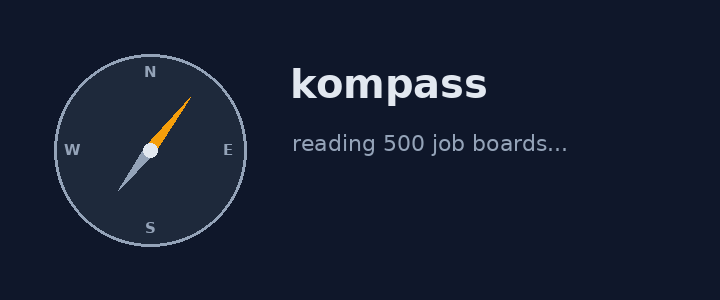
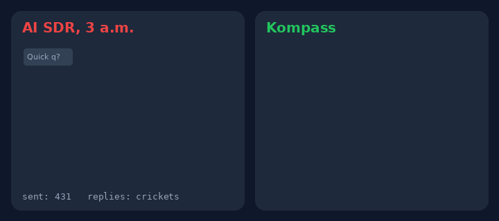
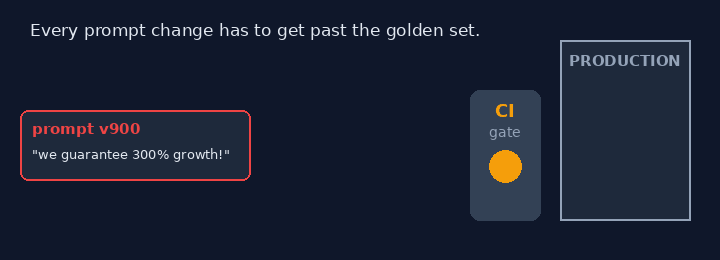
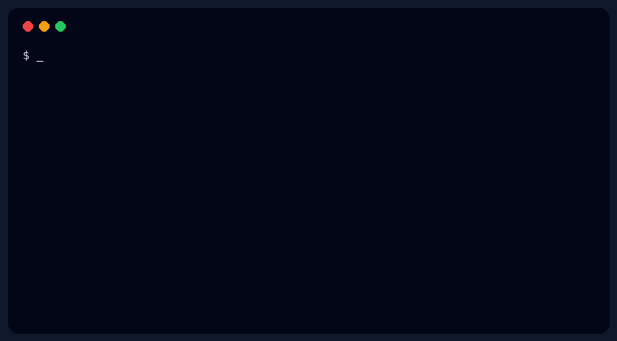

# Kompass 🧭

[](https://github.com/ishacm/kompass/actions/workflows/eval.yml)


**A GTM engine for DACH robotics and industrial-AI startups that finds companies with a real reason to buy *now*, writes one good message instead of a thousand bad ones, and gets smarter every time a human corrects it.**

*Agents propose. Evals check. Humans approve.*

<p align="center"></p>

---

## Why this exists

Cold email reply rates keep falling because inboxes are full of almost-personalised AI spam. The fix isn't more volume. It's better timing, real evidence, and a human in the loop.

<p align="center"></p>

## What's inside

| | Module | In one line |
|---|---|---|
| 🧠 | [**Context layer**](specs/01-context-layer.md) | Every target company, scored against a written ICP and labelled from its own website. Claude can query it over MCP. |
| 📡 | [**Signal agent**](specs/02-signal-agent.md) | Reads job boards, spots "they just started hiring sales", and drafts a cited note. Nothing sends without your OK. |
| 🧪 | [**GTM CI/CD lab**](specs/03-gtm-ci-cd-lab.md) | Prompts ship like code: tested, A/B'd, and improved from your edits through pull requests. |
| 🔍 | [**AEO radar**](specs/04-aeo-radar.md) | Who do AI assistants recommend to buyers, in German *and* English? |
| 📥 | [**Inbound agent**](specs/05-inbound-agent.md) | A contact form that qualifies leads in seconds, says it's an AI, and hands every lead to a human. |

<p align="center"></p>

## Try it in 60 seconds

No API key, no account, no cost:

```bash
git clone https://github.com/ishacm/kompass && cd kompass
pip install -r requirements.txt pytest
python scripts/demo.py        # all five modules, end to end
KOMPASS_LLM=mock pytest -q    # 78 tests
```

<p align="center"></p>

> Mock mode swaps the AI for simple rules. It proves the plumbing works; it doesn't produce results to brag about.

## Run it for real (still €0)

1. Get a free [Groq](https://console.groq.com) key and add it as `GROQ_API_KEY` in **Settings → Secrets → Actions**.
2. Set the variable `KOMPASS_ENABLED=true`. Signals now run every weekday on GitHub Actions.
3. Optional: deploy the inbound form with **Render → New → Blueprint** (`render.yaml` is the free plan).

<details>
<summary><b>Commands for running locally</b></summary>

```bash
cp .env.example .env                          # fill in GROQ_API_KEY (never committed)
python -m kompass.ingest data/seed_accounts.csv
python -m kompass.classify && python -m kompass.score && python -m kompass.report
python -m kompass.signals.run --detect        # job boards -> signals -> drafts
python -m kompass.review.cli --reviewer you   # approve / edit / reject
python eval/run_eval.py --versions v1 v2      # compare prompts on the golden set
python -m kompass.aeo.run && python -m kompass.aeo.analyze --emit-signals
uvicorn kompass.inbound.app:app --port 8080   # the contact form
claude mcp add kompass -- python -m kompass.mcp_server
```
</details>

<details>
<summary><b>What "free mode" trades off</b></summary>

| Piece | Free option | Trade-off |
|---|---|---|
| AI | Groq free tier | Daily limits; drafts a notch below Claude (`KOMPASS_PROVIDER=anthropic` + `KOMPASS_ALLOW_PAID=true` to switch) |
| Scheduled jobs + CI | GitHub Actions | Free on public repos |
| AEO radar | Gemini free tier | Measures Gemini only; ChatGPT/Claude need paid APIs |
| Inbound form | Render free + HubSpot free CRM | Sleeps after 15 min idle (ping `/healthz`); leads live in HubSpot |
</details>

## Safety rails 🛡️

- **Humans approve everything** that reaches a prospect. Prompt changes need a merged PR.
- **Every claim has a source:** segments cite the company's website, drafts cite the job post.
- **DACH-aware:** suggests LinkedIn or a call where cold email is legally risky (UWG §7); the inbound form discloses AI use (EU AI Act Art. 50) and asks for consent.
- **No secrets in code:** keys live in GitHub/Render secrets; CI fails if anything key-shaped is committed.
- **No surprise bills:** paid AI providers are blocked unless explicitly allowed.

## How it was built

Each module was built, then torn apart in a senior-GTM-engineer review, then fixed before moving on. The whole story, including what failed first time, is in **[REVIEWS.md](REVIEWS.md)**.

<details>
<summary><b>Repo map</b></summary>

```
context/    ICP + positioning, written for agents
kompass/    pipeline code: signals/ review/ learn/ aeo/ inbound/
prompts/    versioned prompts + registry (live version, A/B split)
eval/       golden set, judge, CI gate, hand-label checks
aeo/        buyer questions (DE + EN) and vendor list
specs/      one spec per module
tests/      78 tests + fixtures
docs/       the GIFs above (python docs/make_gifs.py)
```
</details>

### Before quoting any number

The repo ships with 9 seed accounts and synthetic test data, so every number above comes from mock mode. Real results need about 150 verified accounts, hand-labelled checks and a live run, each dated with its method stated. That's the next step.

---

<sub>MIT licensed · built by [Isha Chaudhari](https://github.com/ishacm) · GIFs are original and generated by <code>docs/make_gifs.py</code></sub>
